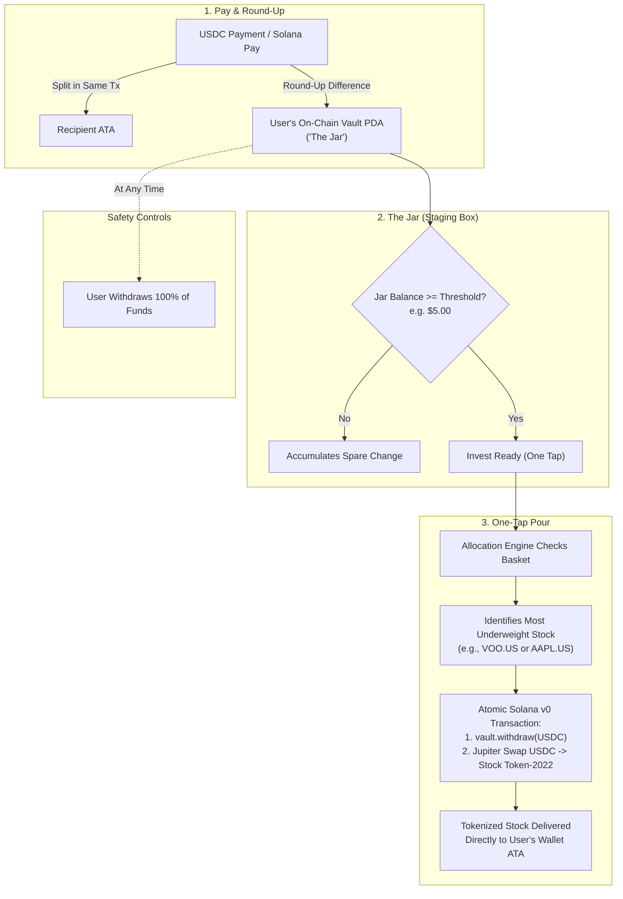

# JIRO (次郎)

> **Crypto-Native Spare-Change Micro-Investing on Solana**  
> Turn everyday USDC payments into automated micro-investments in tokenized US equities on the **Solana Seeker**.

[](https://solana.com)
[](https://www.anchor-lang.com)
[](https://developer.android.com)
[](https://developer.android.com/jetpack/compose)
[](https://jup.ag)
[](https://www.rust-lang.org)
[](https://kotlinlang.org)

---

## Table of Contents

- [Overview](#overview)
- [How It Works](#how-it-works)
- [Architecture](#architecture)
- [Repository Structure](#repository-structure)
- [Subsystems & Modules](#subsystems--modules)
  - [1. On-Chain Vault Program (`program/`)](#1-on-chain-vault-program-program)
  - [2. Android Mobile Application (`android/`)](#2-android-mobile-application-android)
  - [3. Backend Keeper Microservice (`keeper/`)](#3-backend-keeper-microservice-keeper)
  - [4. Discovery Engine & Policy Core (`crates/`, `tools/`)](#4-discovery-engine--policy-core-crates-tools)
- [Security Model & Invariants](#security-model--invariants)
- [Getting Started & Local Development](#getting-started--local-development)
  - [Prerequisites](#prerequisites)
  - [Building the Anchor Program](#building-the-anchor-program)
  - [Building the Android App](#building-the-android-app)
  - [Running the Keeper Service](#running-the-keeper-service)
  - [Running Asset Discovery](#running-asset-discovery)
- [Testing](#testing)
- [Documentation Index](#documentation-index)
- [Disclaimers](#disclaimers)

---

## Overview

**JIRO** brings crypto-native spare-change investing to the Solana mobile ecosystem. Whenever a user spends USDC via Solana Pay, in-app transfers, or observed wallet activity, JIRO rounds up the purchase to a configurable step ($0.50, $1.00, $2.00) and atomically routes the spare change into the user's personal on-chain vault—**"The Jar"**.

When the jar reaches a preset threshold (e.g., $5.00+), the user can pour the accumulated USDC into a diversified stock basket with a single tap. JIRO's deterministic allocation engine computes the single most underweight holding and executes an atomic Jupiter DEX swap directly into the user's self-custodial wallet.

### Core Principles

- **100% Non-Custodial**: No pooled balances, no intermediate exchange account, and no custodial keeper. All funds stay inside the user's personal PDA vault until the user signs a withdrawal or investment transaction.
- **The Jar is a Staging Box**: JIRO is not a high-yield savings account or staking pool. The jar has one label: *"waiting to invest"*.
- **Predictable & Honest Math**: Integer base units only (`1 USDC = 1,000,000` micro-USDC). No floating-point inaccuracies, no projected compounding return promises, and no hidden spreads.
- **Safety by Construction**: Built-in $100 USDC hard maximum balance cap, strict transaction simulations before signing, 100 bps slippage limit, 30s quote timeouts, and compile-time isolation preventing devnet code from reaching mainnet.

---

## How It Works



### The Three Flows

1. **Setup Flow** *(1 Wallet Signature)*:
   Initializes the user's `VaultConfig` PDA and vault token account, plus creates idempotent ATAs for basket assets. Rent is calculated and displayed upfront.
2. **Pay Flow** *(1 Wallet Signature)*:
   Executes payment transfer and deposits spare change into the vault within the same atomic transaction:
   $$\text{RoundUp} = \big((\text{step} - (\text{amount} \bmod \text{step})) \bmod \text{step}\big) \times \text{multiplier}$$
3. **Invest Flow ("The Pour")** *(1 Wallet Signature)*:
   Withdraws USDC from the vault PDA and swaps it into the most underweight equity via Jupiter Swap V2 in an atomic Solana v0 transaction compressed using Address Lookup Tables (ALTs).

---

## Architecture

```
┌────────────────────────────────────────────────────────────────────────┐
│                        SOLANA SEEKER (Android)                         │
│                                                                        │
│   ┌───────────────────────────┐    ┌───────────────────────────────┐   │
│   │        :app (UI)          │    │         :core (Domain)        │   │
│   │ - Jetpack Compose / M3    │    │ - Allocation Engine (Deficit) │   │
│   │ - Seed Vault / MWA 2.x    │◄───┤ - Jupiter Swap V2 Provider    │   │
│   │ - Canvas Jar Animation    │    │ - MessageV0 & ALT Compiler    │   │
│   │ - Solana Pay Deep Links   │    │ - SwapTxValidator Allowlist   │   │
│   └─────────────┬─────────────┘    └───────────────┬───────────────┘   │
└─────────────────┼──────────────────────────────────┼───────────────────┘
                  │                                  │
       RPC / MWA  ▼                                  ▼  Jupiter Swap V2
┌───────────────────────────────────┐    ┌───────────────────────────────┐
│       SOLANA ON-CHAIN VAULT       │    │     JUPITER DEX AGGREGATOR    │
│  (AU4qNgE5qEvuULeKTxJgotM2V8e...) │    │      (api.jup.ag/swap/v2)     │
│ - init_vault (max $100 cap)       │    │ - Setup / Swap / Cleanup      │
│ - deposit (CPI check, math safe)  │    │ - Address Lookup Tables       │
│ - withdraw (PDA-signed CPI)       │    │ - Dynamic Route Selection     │
│ - close_vault (reclaims rent)     │    └───────────────────────────────┘
└─────────────────▲─────────────────┘
                  │
                  │ Ed25519 Signed Catalog & Live Quotes
┌─────────────────┴─────────────────┐
│        JIRO KEEPER SERVICE        │
│       (Rust / Axum / Tokio)       │
│ - Verified Backpack Stock Catalog │
│ - Token-2022 Policy Verification  │
│ - Dockerized & Hosted on Render   │
└───────────────────────────────────┘
```

---

## Repository Structure

```
.
├── android/                   # Android Client (Kotlin / Jetpack Compose)
│   ├── app/                   # Mobile application UI, MWA 2.x, ViewModels, Theme
│   │   └── src/main/java/com/jiro/app/
│   │       ├── MainActivity.kt        # Entrypoint & navigation
│   │       ├── MainViewModel.kt       # State machine & wallet orchestration
│   │       ├── SolanaRpcClient.kt     # Lightweight RPC client
│   │       ├── NetworkSecurity.kt     # TLS certificate pinning
│   │       └── ui/                    # Jar canvas, screens & design system
│   └── core/                  # Pure Kotlin/JVM domain engine (Zero Android framework deps)
│       └── src/main/java/com/jiro/core/
│           ├── AllocationEngine.kt    # Deterministic portfolio deficit algorithm
│           ├── JupiterSwapProvider.kt # Jupiter Swap API V2 client
│           ├── MessageV0.kt           # Versioned transaction & ALT compiler
│           ├── SwapTxValidator.kt     # Static and simulation safety validator
│           ├── TransactionBuilders.kt # Atomic [withdraw + swap] transaction builder
│           └── PolicyEngine.kt        # Token-2022 extension policy evaluator
├── program/                   # Solana Smart Contract (Anchor / Rust)
│   ├── programs/vault/src/    # Vault program source (init, deposit, withdraw, close)
│   ├── tests/                 # Anchor integration tests
│   ├── Anchor.toml            # Anchor workspace configuration
│   └── vault-keypair.json     # Deterministic program keypair
├── keeper/                    # Backend Microservice (Rust / Axum)
│   ├── src/                   # HTTP service, catalog signer, quote fetcher
│   ├── tests/                 # Integration tests
│   └── Cargo.toml             # Keeper crate dependencies
├── crates/
│   └── catalog-core/          # Shared Rust domain library for catalog & policy verification
├── tools/
│   └── discovery/             # CLI discovery tool for Backpack Securities assets on Solana
├── docs/                      # Architectural and technical documentation
│   ├── DESIGN.md              # UI/UX design tokens, animations, copy rules
│   ├── SECURITY.md            # Threat model, upgrade authorities, and invariants
│   ├── PROGRAM_INTERFACE.md   # Anchor instructions, accounts, discriminators, and PDAs
│   ├── DISCOVERY.md           # Empirical analysis of 1,170 Backpack equities
│   ├── POLICY.md              # Token-2022 extension security evaluation matrix
│   ├── SMOKE_TEST.md          # Jupiter V2 integration test report & empirical data
│   ├── BACKPACK_FALLBACK.md   # Backpack RFQ fallback bridge architecture
│   ├── catalog_snapshot.json  # Full snapshot of verified stock mints
│   └── presets.json           # Curated basket presets (Index, Big Tech)
├── scripts/                   # CI scripts & operational tooling
│   ├── check-no-mock-in-mainnet.sh  # CI guard ensuring mock code never builds for mainnet
│   └── vault-cli.ts           # TypeScript operational CLI for vault interactions
├── policy.toml                # Canonical Token-2022 extension evaluation policy
├── Dockerfile                 # Multi-stage production build for the Keeper service
└── render.yaml                # Infrastructure configuration for Render deployment
```

---

## Subsystems & Modules

### 1. On-Chain Vault Program (`program/`)

The on-chain Anchor program (`AU4qNgE5qEvuULeKTxJgotM2V8eNygZj14YWDSMU5dqc`) implements four minimalist, audited instructions:

| Instruction | Signer | Discriminator (hex) | Description |
| :--- | :---: | :---: | :--- |
| `init_vault` | Owner | `4d4f559621d9346a` | Initializes `VaultConfig` PDA (`[b"vault", owner, vault_id]`) and creates vault ATA. Sets balance cap (`0 < cap <= 100 USDC`). |
| `deposit` | Owner | `f223c68952e1f2b6` | Moves USDC from owner's ATA to vault ATA via checked CPI. Enforces `vault_balance + amount <= max_balance`. |
| `withdraw` | Owner | `b712469c946da122` | Withdraws funds from vault ATA back to owner's USDC ATA via PDA-signed CPI. |
| `close_vault` | Owner | `8f82eb0ec41c0022` | Closes vault ATA and PDA once balance is 0. Refunds all rent lamports to owner. |

- **Invariants**:
  - `HARD_MAX_BALANCE`: 100 USDC (`100_000_000` base units).
  - Mint decimals strictly enforced to 6.
  - Classic SPL Token program enforced for vault ATA (`TokenkegQfeZyiNwAJbNbGKPFXCWuBvf9Ss623VQ5DA`).
  - Strict feature gating: `--features mock-swap` enables mock pricing for devnet/localnet testing; compiling with both `mainnet` and `mock-swap` triggers `compile_error!`.

### 2. Android Mobile Application (`android/`)

Designed specifically for the **Solana Seeker** using a dark-first OLED palette (`#0E1013` Ink, `#161A1F` Surface, `#FFB84D` Amber, `#5CE0B0` Mint):

- **Pure JVM Domain Core (`:core`)**:
  - **Stock Selection Deficit Engine**: Property-tested allocator. Computes each asset's deficit:
    $$\text{Deficit}_i = \max(0, \text{TargetWeight}_i \times (\text{PortfolioValue} + \text{BuyAmount}) - \text{AssetValue}_i)$$
    Selects the asset with the largest deficit and produces a transparent "Why this stock?" explanation breakdown.
  - **Jupiter Swap API V2 Client**: Connects to `https://api.jup.ag/swap/v2/build` with API key support, parses complex multi-hop instructions, and resolves Address Lookup Tables.
  - **Atomic Transaction Composition**: Merges `vault.withdraw` and Jupiter swap into a single Solana v0 transaction (< 1,232 bytes). Automatically falls back to a safe two-transaction sequential flow if wire size limits are exceeded.
  - **`SwapTxValidator`**: Pre-flight validator checking fee payer, program allowlist, token balance deltas, and SOL rent impact.
- **Compose UI (`:app`)**:
  - Live Canvas jar liquid fill animation with haptic feedback.
  - Solana Mobile Wallet Adapter (MWA 2.x) and Seed Vault integration.
  - Solana Pay deep-link parser (`solana:` URIs).
  - Pre-buy on-chain mint re-verification ensuring decimals, program owner, and extension fingerprints match before prompt.

### 3. Backend Keeper Microservice (`keeper/`)

A high-throughput Rust backend built with **Axum** and **Tokio**:
- Serves the verified Backpack Securities stock catalog signed with Ed25519.
- Fetches real-time price feeds and quotes.
- Provides containerized health checks (`/healthz`) and CORS headers for mobile clients.
- Deployed on Render with TLS certificate pinning support.

### 4. Discovery Engine & Policy Core (`crates/`, `tools/`)

Automated tooling to discover, parse, and verify tokenized assets:
- **1,170 Tokenized Equities Verified**: Analyzed all `.US` equities issued by Backpack Securities on Solana mainnet.
- **Token-2022 Fingerprinting**:
  $$\text{Fingerprint} = \text{SHA256}(\text{owner\_program} : \text{decimals} : \text{sorted\_extensions})$$
  Ensures the mobile app and contract verify mint parameters deterministically before buying.
- **`policy.toml`**: Config-driven security rules mapping token extensions (`permanent_delegate`, `pausable`, `transfer_hook`, `freeze_authority`) to `OK`, `WARN`, or `BLOCK` actions with required user disclosures.

---

## Security Model & Invariants

| Attack Vector | JIRO Mitigation Strategy |
| :--- | :--- |
| **Malicious / Compromised RPC** | Catalog payloads are signed with Ed25519; client re-fetches mint on-chain and verifies extension fingerprint before first purchase. |
| **Fake Ticker / Impersonation** | Ticker presets only define search keys; mints must resolve to the Backpack verified master issuer key (`2cVYpagTt7ZGc3mmTXBa7fAznUtx5DUu6aCq8uVDaf4a`). |
| **Slippage & Sandwich Attacks** | Strict 100 bps max slippage cap, 100 bps max price impact cap, and 30-second quote expiry TTL. |
| **Unauthorized Token Drain** | `SwapTxValidator` simulates transaction and ensures user USDC balance decreases by *exactly* the specified amount, output balance increases by $\ge \text{minOut}$, and no other assets decrease. |
| **Arbitrary CPI / Drain in Program** | Vault ATA authority is strictly the `vault_config` PDA. CPI destinations are locked to owner ATAs. |
| **Accidental Mock in Production** | Cargo features `mainnet` and `mock-swap` mutually `compile_error!`. CI runs `scripts/check-no-mock-in-mainnet.sh` to fail if mock instructions appear in the mainnet IDL. |

---

## Getting Started & Local Development

### Prerequisites

- **Rust**: `1.80.0` or higher (`rustup update`)
- **Solana CLI**: `1.18.0` or higher
- **Anchor CLI**: `0.30.1`
- **JDK**: OpenJDK 17 or higher
- **Android SDK**: API level 35, Build Tools 35.0.0
- **Node.js**: `v20+` (for TypeScript tooling and Anchor test scripts)

---

### Building the Anchor Program

```bash
# Navigate to program directory
cd program

# Install npm dependencies for test runners
npm install

# Build localnet/devnet version (includes mock-swap)
anchor build

# Run localnet Anchor tests
anchor test

# Build for mainnet verification (ensures mock instructions are excluded)
cd ..
./scripts/check-no-mock-in-mainnet.sh
```

---

### Building the Android App

```bash
# Run unit tests across pure Kotlin/JVM domain core (:core)
./gradlew :core:test

# Assemble debug APK for Solana Seeker / Android Device
./gradlew :app:assembleDebug

# The APK will be generated at:
# android/app/build/outputs/apk/debug/app-debug.apk
```

To install directly to a connected device:
```bash
adb install -r android/app/build/outputs/apk/debug/app-debug.apk
```

---

### Running the Keeper Service

```bash
# Copy and configure environment variables
cp .env.example .env

# Run keeper service locally on port 3000
cargo run -p keeper

# Verify health status
curl http://localhost:3000/healthz
```

Or run via Docker:
```bash
docker build -t jiro-keeper .
docker run -p 3000:3000 jiro-keeper
```

---

### Running Asset Discovery

To query Backpack Securities APIs and verify on-chain mints on Solana:

```bash
# Run the discovery tool against Solana mainnet
cargo run -p discovery -- --output docs/catalog_snapshot.json
```

---

## Testing

JIRO adheres to strict property and contract testing across all modules:

```bash
# 1. Run all Kotlin domain logic and Jupiter integration tests (75+ passing tests)
./gradlew test

# 2. Run Anchor on-chain test suite
cd program && anchor test

# 3. Run Rust workspace unit and contract tests
cargo test --workspace
```

---

## Documentation Index

Detailed architectural briefs and engineering specifications are available in the [`docs/`](docs/) directory:

- [**Design Brief (`docs/DESIGN.md`)**](docs/DESIGN.md) - Design tokens, typography, motion curves, states, and microcopy guidelines.
- [**Security Specification (`docs/SECURITY.md`)**](docs/SECURITY.md) - Threat matrix, multisig roadmaps, upgrade authority management, and invariants.
- [**Program Interface Specification (`docs/PROGRAM_INTERFACE.md`)**](docs/PROGRAM_INTERFACE.md) - Anchor instruction byte layouts, discriminators, and account structures.
- [**Asset Discovery Report (`docs/DISCOVERY.md`)**](docs/DISCOVERY.md) - Empirical analysis of Backpack Securities Token-2022 mints and extension fingerprints.
- [**Token-2022 Security Policy (`docs/POLICY.md`)**](docs/POLICY.md) - Extension evaluation matrix and disclosure rules.
- [**Jupiter Integration & Smoke Test Report (`docs/SMOKE_TEST.md`)**](docs/SMOKE_TEST.md) - Jupiter V2 benchmark results, ALT compression metrics, and live smoke test results.
- [**Backpack RFQ Fallback Bridge (`docs/BACKPACK_FALLBACK.md`)**](docs/BACKPACK_FALLBACK.md) - Secondary RFQ liquidity architecture.

---

## Disclaimers

> **Regulatory & Asset Notice**: Tokenized stocks traded through JIRO are tokenized financial instruments issued under Backpack Securities compliance frameworks, not registered stock certificates or direct shares.
> 
> **No Financial Advice**: JIRO is an open-source decentralized technology interface. Nothing contained within this repository constitutes financial, legal, or investment advice.
> 
> **Software Notice**: Smart contracts and mobile client software are provided "as is" under active development. Vault balances are capped at $100 USDC for experimental safety. Use at your own risk.
